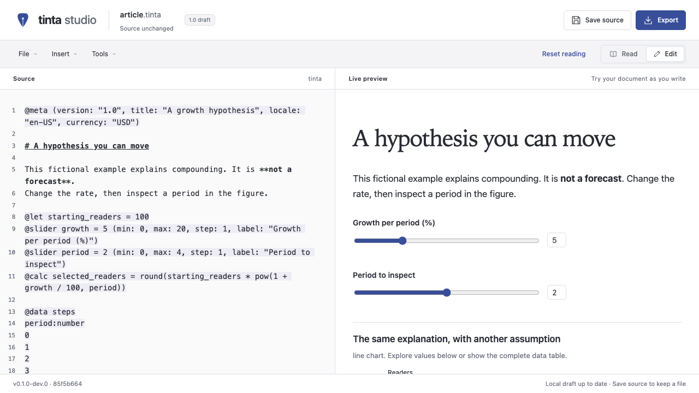

<p align="center">
  
</p>

<p align="center">
  <strong>A language for documents you can explore.</strong>
</p>

<p align="center">
  <a href="https://planta7.github.io/tinta/">Try the studio</a> ·
  <a href="#write-in-vs-code">Use VS Code</a> ·
  <a href="examples/README.md">Explore examples</a> ·
  <a href="docs/CHEATSHEET.md">Syntax cheatsheet</a> ·
  <a href="spec/00_OVERVIEW.md">Read the specification</a>
</p>

---

**tinta is a language for interactive documents.** It brings writing, data and interaction into a single document. Readers can explore a question, compare scenarios and see how their choices change the explanation.

An article that invites questions. A report where readers can test their assumptions. A guide that gives each reader the explanation they need.

Choose the tool that fits your work. **Studio** is the browser editor, the **VS Code extension** brings authoring into your desktop editor, and the **CLI** validates and exports documents from the terminal. They share the same language and engine. Exported HTML opens independently of all three.

## Meet tinta studio

> [!TIP]
> **Try tinta studio live.** [Open the browser demo →](https://planta7.github.io/tinta/)
> Explore an example, change a control and watch the document respond. No account needed.

Write on the left. Read and interact on the right.



_The included [explorable article](examples/article.tinta), open in tinta studio._

- **See your ideas take shape.** Write and see the document update beside you. Search, undo and clear error messages help you keep going.
- **A starting point when you need one.** Browse rendered examples and reusable snippets. Bring an existing Markdown file or import local CSV, JSON and raster images.
- **A reader that participates.** Move a slider, choose a scenario or inspect a chart. The explanation stays connected to the same underlying data.
- **Pick up where you left off.** Recovery copies help you return to a draft. Save your work, then export the finished document for your readers.

New documents open ready to type. Existing documents open in Reading mode. Studio runs as a static web app or as a single local HTML file, without an account or backend. You can also [run it locally](#try-it-locally).

## Write in VS Code

The local VS Code Desktop extension brings `.tinta` documents into your editor: directive and expression completion, diagnostics, hover help, definitions and references, plus an interactive preview with controls and charts.

Enrich an existing Markdown file into a separate tinta document, select local images, open and save source bundles, and export interactive or static HTML. Markdown files keep their normal editing behavior. Image, bundle, enrichment and export commands require a trusted workspace.

After installing the [repository toolchain and dependencies](#try-it-locally), build the local extension:

```sh
pnpm package:vscode
```

In VS Code, run **Extensions: Install from VSIX…**, select `build/vscode/tinta-0.1.0-dev.0.vsix`, then reload. Open a `.tinta` file and run **tinta: Open Preview**.

Use the extension in VS Code Desktop on macOS arm64, Linux arm64 or Windows x64. Remote workspaces and vscode.dev are unsupported. Rename, quick fixes and formatting are not available.

See the [VS Code quickstart](docs/14_VSCODE_QUICKSTART.md) for examples, local installation, diagnostics and exports, and the [host reference](docs/13_VSCODE.md) for behavior and limits.

## A small document, a real interaction

This is a complete document:

```tinta
@meta (title: "Plan a reading session", locale: "en-US")
@let minutes_per_page = 2

# How much time should we set aside?

@slider pages = 8 (min: 1, max: 40, label: "Pages")
@toggle discussion = false (label: "Include a discussion")
@calc minutes = pages * minutes_per_page + if(discussion, 15, 0)

Reading **{{ pages }} pages** takes about **{{ minutes }} minutes**
with these choices.

@when minutes > 45
Consider dividing the reading into two sessions.
@end
```

Move the slider. Include a discussion. The total changes, and the advice appears when it becomes relevant. **No author JavaScript, event handlers or build setup inside the document.**

tinta uses Markdown for text formatting and adds its own syntax for values, calculations, controls, data and conditional content. It supports CommonMark 0.31.2, with pipe tables, task lists and double-tilde strikethrough. A `.md` file stays in Markdown mode until you explicitly choose **Enrich as tinta**; the original file is preserved.

## Try it locally

Use **Node 24.21.0** and **pnpm 10.34.6**. From a checkout:

```sh
pnpm install --frozen-lockfile
pnpm dev
```

Open the loopback URL printed by Vite, then choose **Explore examples** or **New document**. You can also open `.md`, `.tinta` and `.tinta.zip` files.

<details>
<summary><strong>Prefer the production build or a standalone file?</strong></summary>

```sh
pnpm build
pnpm preview
```

The static application lives in `build/studio/`. Hash URLs support refresh without server rewrites.

For a server-free workspace, open **`build/tinta-studio.html`** directly in a browser. It contains the editor and its runtimes in one local file. Browser storage and file permissions still depend on the environment; local recovery copies are not a substitute for saving your source.

See the [setup and toolchain guide](docs/09_FOUNDATION_TOOLCHAIN.md) for prerequisites and troubleshooting.

</details>

<details>
<summary><strong>Prefer the command line?</strong></summary>

After `pnpm build`, validate and export an included example:

```sh
pnpm --filter @tinta-lang/cli exec tinta check examples/article.tinta
pnpm --filter @tinta-lang/cli exec tinta build examples/article.tinta \
  --format interactive --output build/article.interactive.html
pnpm --filter @tinta-lang/cli exec tinta build examples/article.tinta \
  --format static --output build/article.static.html
```

Open either output in a browser. Interactive HTML keeps the controls; static HTML captures the visible document with its initial answers. Replacing an existing output requires an explicit `--force`.

The [CLI reference](docs/06_CLI.md) covers validation, enrichment, imports, exports, answer snapshots and exit codes.

</details>

Studio targets modern desktop Chromium, Firefox and Safari; the reader and HTML exports also support narrow layouts. Browser storage, file permissions and assistive technology vary by environment. See the [usage environments](docs/01_PRODUCT.md#supported-usage-environments) and [accessibility requirements](docs/05_ACCESSIBILITY_AND_DESIGN.md). Automated WebKit results do not establish native Safari or iOS compatibility.

## More than a slider

| In your document                      | What it does                                                               |
| ------------------------------------- | -------------------------------------------------------------------------- |
| `@slider` · `@toggle` · `@choice`     | Let the reader adjust a number, switch an option or choose a scenario.     |
| `@let` · `@calc` · `{{ expression }}` | Connect constants and calculated values to the prose.                      |
| `@when` · `@details`                  | Adapt an explanation or let the reader open more context.                  |
| `@data` · `@view` · `@table`          | Embed typed data and reuse filtered views across text, tables and figures. |
| `@chart`                              | Explore line, area, bar, scatter, pie, donut and histogram figures.        |

Charts include keyboard exploration and a complete data table. Compatible charts can bind selection to an existing control; histograms support inspection. Invalid answer updates leave the previous valid document intact.

Start with the [cheatsheet](docs/CHEATSHEET.md), then explore the [expression rules](spec/02_EXPRESSIONS_AND_STATE.md), [directives](spec/03_DIRECTIVES.md), [data model](spec/04_DATA.md) and [chart specification](spec/05_CHARTS.md).

## Open an example. Change one thing.

| Document                                                 | Try this                                                  |
| -------------------------------------------------------- | --------------------------------------------------------- |
| [An article you can explore](examples/article.tinta)     | Change the growth assumption and inspect a period.        |
| [A report with shared filters](examples/report.tinta)    | Watch totals, tables and charts respond to the same view. |
| [A guide that adapts](examples/guide.tinta)              | Choose a platform and follow the relevant instructions.   |
| [Seven ways to see the data](examples/chart-atlas.tinta) | Compare all seven chart types in one document.            |

The [example collection](examples/README.md) also includes a minimal starting point, function examples, Markdown enrichment and a [portable image bundle](examples/local-image.tinta.zip).

## Save and share your document

| Format               | What you keep                                                        |
| -------------------- | -------------------------------------------------------------------- |
| `.tinta`             | Editable UTF-8 source and embedded table data.                       |
| `.tinta.zip`         | Source together with validated local raster images.                  |
| **Interactive HTML** | A complete offline document with controls and its embedded runtime.  |
| **Static HTML**      | The resolved visible presentation, without an executable program.    |
| `.tinta.state.json`  | Explicitly saved reader answers tied to an exact source fingerprint. |

**Interactive HTML includes the complete source, hidden branches and all embedded data.** Hidden does not mean private. Static export contains the resolved visible presentation and its referenced images. See the [file and export contract](docs/02_FILES_AND_EXPORTS.md) for the exact boundaries.

Studio's local recovery stores up to 10 copies and 30 MiB, replacing the oldest copies first. It can be disabled, and copies can be deleted. Reader answers are not automatically persisted. Studio can explicitly export an answers snapshot; the CLI can apply a matching snapshot during export. The VS Code preview keeps answers in memory and can include them in HTML exports, but does not provide snapshot import/export. [How saving and recovery work →](docs/03_EDITOR_AND_READER.md)

CSV and JSON imports in Studio or the CLI copy data into typed document tables; they do not retain a live connection to the original file. Images must be validated local raster files. Use a source bundle when moving a document together with its images. See the [data and import rules](spec/04_DATA.md) and [file formats](docs/02_FILES_AND_EXPORTS.md).

## A small language. Clear boundaries.

Documents cannot execute author JavaScript, CSS, HTML, plug-ins or code fences, fetch remote data, or submit forms. Raw author HTML is inert; code fences remain literal examples. Local files and images pass through explicit capability boundaries.

tinta focuses on interactive documents. There is no cloud storage, account system, telemetry, AI feature, website generator or publication service. PDF and flattened Markdown exports are outside the current scope. See the [product scope](docs/01_PRODUCT.md) and [security model](docs/04_SECURITY.md).

## Build with the engine

The parser and semantic engine are portable TypeScript. The reader and export runtime are independent of React and CodeMirror; those belong to the studio.

| Layer                                               | Documentation                                                                                         |
| --------------------------------------------------- | ----------------------------------------------------------------------------------------------------- |
| Parse and enrich Markdown                           | [Syntax API](docs/10_SYNTAX_API.md)                                                                   |
| Compile, evaluate and manage transactional sessions | [Engine API](docs/11_ENGINE_API.md)                                                                   |
| Render safe documents, controls and charts          | [Reader API](docs/12_READER_API.md)                                                                   |
| Integrate editor analysis and native previews       | [Editor analysis](contracts/editor-analysis.d.ts) · [Webview protocol](contracts/vscode-webview.d.ts) |
| Understand package boundaries                       | [Architecture](architecture/MODULES.md) · [Stack](architecture/STACK.md)                              |
| Work with public contracts                          | [Interfaces](contracts/public-api.d.ts) · [Contract rules](contracts/CONTRACT_RULES.md)               |

## Documentation

| Looking for                                   | Start here                                                                                                       |
| --------------------------------------------- | ---------------------------------------------------------------------------------------------------------------- |
| Syntax and complete documents                 | [Cheatsheet](docs/CHEATSHEET.md) · [Examples](examples/README.md)                                                |
| Studio editing, imports, saving and recovery  | [Editor and reader guide](docs/03_EDITOR_AND_READER.md)                                                          |
| VS Code installation and everyday use         | [Quickstart](docs/14_VSCODE_QUICKSTART.md) · [Host behavior and limits](docs/13_VSCODE.md)                       |
| Terminal commands and automation              | [CLI reference](docs/06_CLI.md)                                                                                  |
| Source bundles, answers and HTML exports      | [File and export formats](docs/02_FILES_AND_EXPORTS.md)                                                          |
| Language semantics and error codes            | [Specification](spec/00_OVERVIEW.md) · [Limits and diagnostics](spec/06_LIMITS_AND_DIAGNOSTICS.md)               |
| Keyboard use, charts and accessible reading   | [Accessibility and design](docs/05_ACCESSIBILITY_AND_DESIGN.md)                                                  |
| Local resource access and untrusted documents | [Security model](docs/04_SECURITY.md) · [Security reporting](SECURITY.md)                                        |
| Development setup and checks                  | [Toolchain](docs/09_FOUNDATION_TOOLCHAIN.md) · [Testing](docs/07_VERIFICATION.md) · [Scripts](scripts/README.md) |
| Package formats and versions                  | [Software distribution](docs/15_DISTRIBUTION.md) |
| Scope and compatibility                       | [Product contract](docs/01_PRODUCT.md) · [Decisions](DECISIONS.md) · [Change control](docs/08_CHANGE_CONTROL.md) |

## Status

**Draft language. Working local tools.**

Contract revision **1.0-draft.3** targets source-format version **1.0**. The repository contains the specification, reusable packages, CLI, Studio and local VS Code extension. The language contract is still a draft; format version 1.0 does not identify a stable tool release. Workspace packages currently use implementation version `0.0.0`; the local VSIX uses development version `0.1.0-dev.0`.

## Contribute

Read [CONTRIBUTING.md](CONTRIBUTING.md), the [architecture](architecture/MODULES.md) and [compatibility rules](docs/08_CHANGE_CONTROL.md) before proposing language or contract changes. Report security issues through [SECURITY.md](SECURITY.md).

<details>
<summary><strong>Run the existing checks</strong></summary>

```sh
pnpm exec playwright install chromium firefox webkit
pnpm verify
```

`pnpm verify` runs the infrastructure aggregate. `pnpm verify --suite editing` adds the implemented document-tooling and editor checks. Dependency auditing needs access to the npm advisory service.

For the native extension, run `pnpm verify --suite vscode` after provisioning VS Code Desktop and setting `TINTA_VSCODE_EXECUTABLE` and `TINTA_VSCODE_CLI` to its executable and CLI launcher. This suite includes local VSIX packaging and installed-extension workflows; missing desktop prerequisites return nonzero. See the [native test instructions](scripts/README.md#local-vs-code-artifact).

Specification consistency checks use Python's standard library:

```sh
python3 scripts/check_spec.py
python3 -m unittest discover -s scripts/tests -v
```

See [testing and performance](docs/07_VERIFICATION.md), [conformance fixtures](conformance/README.md) and [checker prerequisites](scripts/README.md).

</details>

## License

The original specification, engine, reference tools, fixtures and examples are available under the [MIT License](LICENSE). Bundled dependencies retain their own licenses, collected in `THIRD_PARTY_NOTICES.txt` at the repository root.
